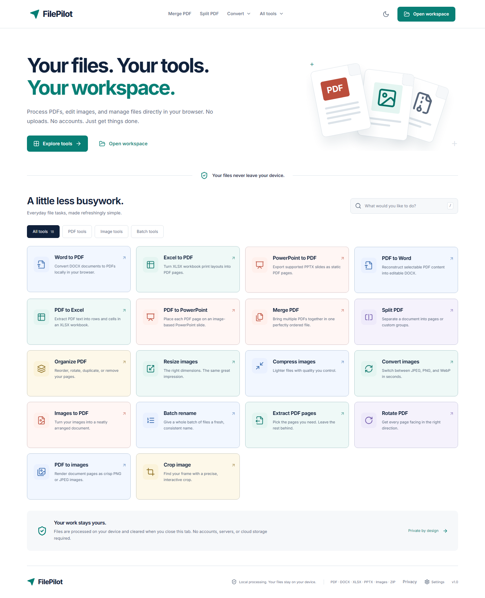

# FilePilot

**Your files. Your tools. Your workspace.**

A free browser-based toolkit for PDFs, images and batches of files. Processing happens on the user's device. No accounts, document uploads, hosted database, analytics or external conversion API.

Read the [privacy notice](PRIVACY.md), also available in the app at `/privacy` through the footer, Settings and mobile navigation. The notice covers local files, theme storage, downloads, hosting connection data and external links. Its shared content is maintained in `src/content/privacy.json`; run `npm run privacy:sync` after editing it to update the repository copy.



## Features

- Responsive layouts for phones, tablets, laptops and desktops, including touch-sized controls, scrollable menus and prominent downloads.
- A dedicated completion screen replaces the editing workspace after processing. It shows tool-specific messages, filename/format/size, conversion notes and primary downloads; batches offer ZIP and an expandable list of individual downloads. Process Another File clears the current selection/results while preserving preferences. Review files and settings retains the result; retries preserve successes, and other tools' latest downloads remain available in the workspace.
- Merge, split, organize, rotate and extract PDF pages, with real thumbnails and accessible ordering controls.
- Convert DOCX, XLSX and PPTX to PDF using local workers and bundled fonts; reconstruct PDFs into editable DOCX. Export PDF text to XLSX cells or PDF page images to PPTX slides. See the conversion notices for formatting limitations.
- Render selected PDF pages as JPEG/PNG; export multiple results as ZIP.
- Create A3/A4/A5/A6, Short/Letter, Long/Folio, Legal, Tabloid and Executive PDFs from ordered images, with orientation, margins and alignment.
- Resize images by dimensions, width, height or percentage; contain, cover and explicit stretch modes.
- Crop with mouse/touch, numeric fields, keyboard movement, fixed/custom ratios, zoom and a live preview.
- Convert JPEG/PNG/WebP using verified browser encoders; choose JPEG transparency background.
- Compress JPEG/WebP with optional dimension reduction, accurate size comparisons and optional original retention.
- Rename copies with prefixes, suffixes, find/replace, case conversion, numbering and collision-safe ZIP export.
- Light, dark and system themes; searchable catalog; session workspace, progress, cancellation and partial batch retry.

## Run

Requires Node.js **22.12+** and npm. Tested with Node 22.20.

```sh
npm ci
npm run dev
```

Open the URL printed by Vite (normally `http://127.0.0.1:5173`).

```sh
npm run typecheck
npm test
npx playwright install chromium
npm run test:e2e
npm run build
npm run preview
```

To test built assets instead of the development server, set `FILEPILOT_PRODUCTION=1` before `npm run test:e2e`. Prettier is available with `npx prettier --write src tests docs`.

## Stack and structure

React + TypeScript strict + Vite, Tailwind CSS v4, shadcn-style Button and Radix dialog primitives, Lucide, React Router, Zustand and Zod. Processing uses pdf-lib, PDF.js, Ream and fflate. Inter UI fonts, Liberation Sans conversion fonts and processing workers are locally bundled. No Office document is sent to a remote conversion API.

```text
src/
  components/        Shared shell, upload, previews, results, UI primitives
  features/          Catalog, tool workspace, options, cropper, page grid, settings
  processing/        PDF, image, archive, renderer, engine and worker services
  stores/            In-memory workspace/job state
  lib/               Validation, page ranges, filenames, catalog and theme
tests/               Unit, component and cross-browser end-to-end checks
public/              Favicon, SPA fallback and Cloudflare security headers
docs/                Architecture, design, processing, verification and deployment
.github/workflows/   Build and test CI
```

## Privacy, formats and limits

Source files and generated results remain in memory until cleared or the tab closes/refreshes. Only theme is persisted in localStorage. No document data is sent to a server. Initial application assets need to load before tools can run; there is no offline/PWA guarantee. Active files are shared for the current tool; switching tools starts a fresh input selection and preserves completed results. Options are remembered during the tab session.

PDF, DOCX, XLSX, PPTX, JPEG, PNG and WebP inputs are supported. Rename accepts arbitrary non-empty file types and exports copies without opening their content. ZIP is output-only. Unsupported formats include legacy DOC/XLS/PPT, encrypted or macro-enabled Office files, HEIC, SVG and GIF. There is no OCR, PDF password removal, AI upscaling or guaranteed file-size reduction. Office conversions are best effort: formatting and fonts can change; PDF-to-XLSX restores text cells rather than formulas, and PDF-to-PPTX uses images rather than editable text/shapes.

Limits: 100 MB per input, 300 MB per selection/results/ZIP content, 100 files per batch, 2,000 pages per source PDF, 50 million source image pixels, and 32 million output pixels with a maximum 8,192 per image edge. Actual capacity depends on the browser and device. Image metadata/animation and PDF document-level features may not be preserved. Check important outputs.

Office inputs have a stricter 20 MB ZIP/80 MB expanded/2,000-part limit. Office conversions are single-file jobs with at most 200 output/selected pages and a 90-second worker timeout. Spreadsheet extraction allows 100,000 cells, 512 columns, ten million total text characters and 32,767 characters per cell. Rendered slides are limited to 60 MB and a PowerPoint slide size of 1–56 inches. Unsupported glyphs are rejected rather than silently replaced with missing characters.

## Verification and deployment

See [testing results](docs/TESTING.md) for executed checks and their limits. For free static hosting, connect the repository to Cloudflare Pages with build command `npm run build` and output directory `dist`. No backend or environment secrets are needed. [Deployment instructions](docs/DEPLOYMENT.md) describe SPA fallback and security headers. The application has **not** been deployed.

See the [implementation plan](docs/IMPLEMENTATION_PLAN.md), [architecture](docs/ARCHITECTURE.md), [feature specification](docs/FEATURE_SPECIFICATION.md), [processing engine](docs/PROCESSING_ENGINE.md), [design system](docs/DESIGN_SYSTEM.md) and [known limitations](docs/KNOWN_LIMITATIONS.md).
